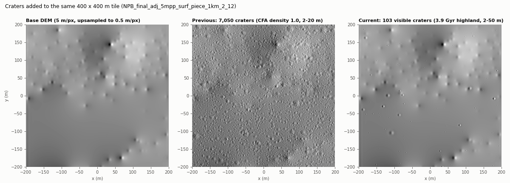
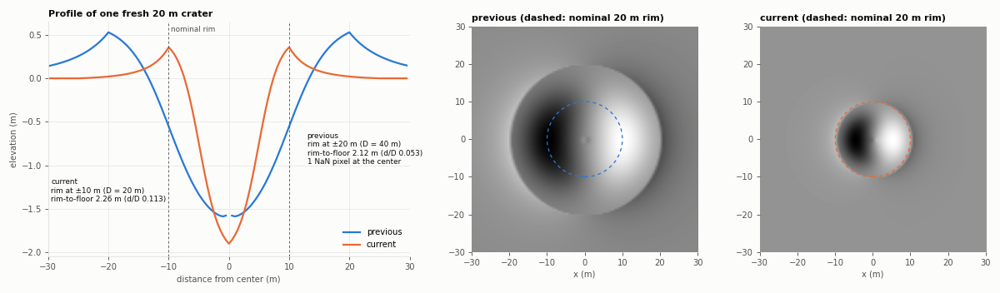
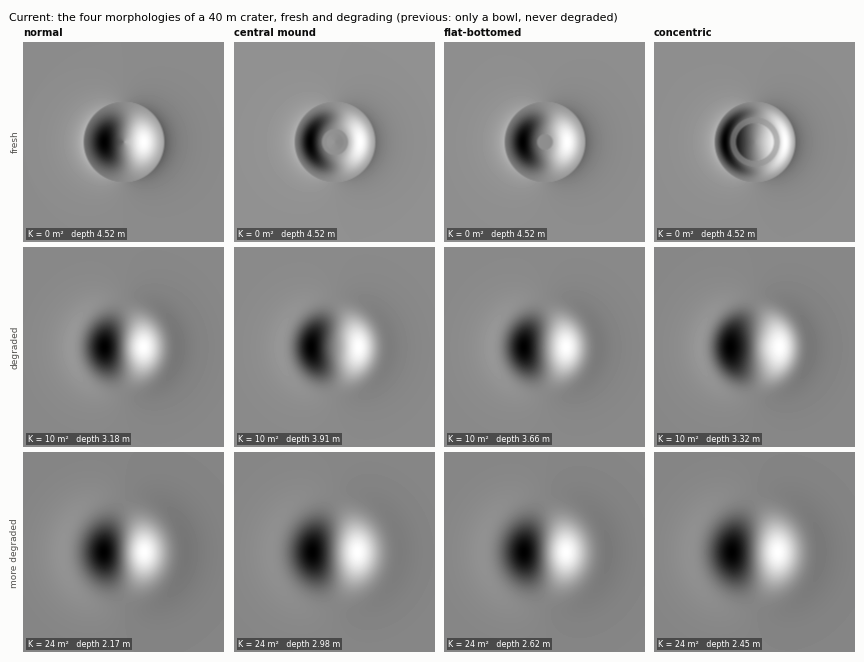
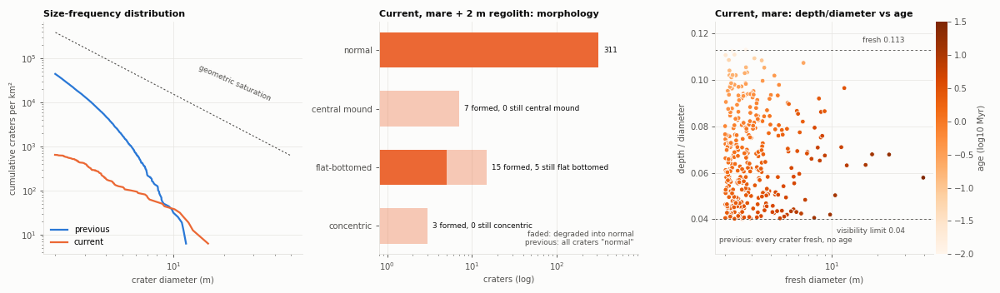
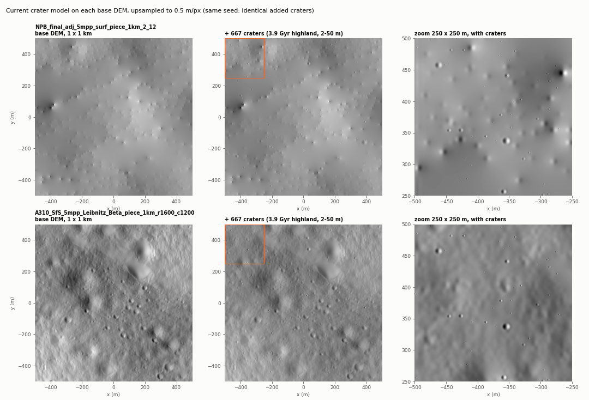

# Crater Model

LuNaSynth adds small craters (about 1 to 50 m) to the base DEMs, below the size the base DEM resolves. Each crater
has a size, an age and a morphology. Its shape is the fresh shape of its morphology, degraded by topographic diffusion
for its age. The implementation is in {py:mod}`lunasynth.craters`, and {py:class}`~lunasynth.terrain_enhancement.CraterField`
uses it to generate the craters of each terrain.

## Configuration

```yaml
terrain:
  crater_field:
    terrain: "highland"    # or "mare"
    surface_age_ga: 3.9    # Gyr, can be a distribution
    morphology: "auto"     # or normal, central_mound, ...
    d_min: 2               # m, smallest fresh crater
    resolvable_pixels: 10  # base DEM pixels
```

| Option | Default | Description |
|---|---|---|
| `terrain` | `highland` | `highland` or `mare`, sets the degradation rate and the regolith thickness |
| `surface_age_ga` | 3.9 | Age of the surface in Gyr; sets how many craters have formed |
| `morphology` | `auto` | `auto` selects it from the regolith thickness; or `normal`, `central_mound`, `flat_bottomed`, `concentric` |
| `d_min` | 2 | Smallest fresh crater diameter, m |
| `resolvable_pixels` | 10 | Only craters smaller than this many pixels of the base DEM are added |
| `d_max` | | Largest fresh crater diameter, m, at most `resolvable_pixels` × base pixel size |
| `regolith_thickness` | 6.5 (highland), 4 (mare) | Median regolith thickness, m |
| `visibility_depth_ratio` | 0.04 | Craters shallower than this depth / diameter are not generated |
| `kappa_800`, `phi` | from `terrain` | Diffusivity κ(D) = κ₈₀₀ (D / 800 m)^φ in m²/Myr |
| `chronology` | `neukum2001` | Lunar chronology function, `neukum2001` or `yue2022` |

Each crater is saved to `crater_field.csv` with its position (in the same frame as the rocks and the rendered
mesh), current and fresh diameter, fresh and current morphology, age, degradation state, depth and rim height.

## Sizes and ages

Crater diameters and ages follow the lunar production and chronology functions of Neukum et al. (2001), with the
coefficients of [craterstats](https://github.com/ggmichael/craterstats). The cumulative number of craters larger
than D formed on a surface of age T is

$$N(>D, T) = N_1(T)\,10^{\sum_i a_i (\log_{10} D)^i - a_0}$$

$$N_1(T) = 5.44\times10^{-14}\,(e^{6.93T}-1) + 8.38\times10^{-4}\,T$$

with D in km, N in km⁻² and T in Gyr. Its cumulative slope is about -3.1 for 10 to 100 m craters. The function is
defined above 10 m; below, it is extended as a power law with its slope at 10 m. The chronology of Yue et al. (2022),
calibrated with the Chang'e-5 samples, is available with `chronology: yue2022`; the ages of the Chang'e-6 basalts
(Zhang et al., 2024) show that the nearside chronology also applies to the farside.

Crater size distributions are power laws. The rock model `F(D) = k exp(-q D)` with `q = A + B / k`
(Golombek & Rapp, 1997; lunar A and B from Li & Wu, 2018) describes rocks only, and is used for rocks in
{py:class}`~lunasynth.terrain_enhancement.CfaModel`.

## Fresh shapes

Fresh craters take one of the four morphologies of small lunar craters, with the profiles of Yang et al. (2021),
Table 1. The radial distance r is normalized by the crater radius (rim at r = 1) and the elevation by the diameter.
All have a rim-to-floor depth of 0.113 D and ejecta that reach the surrounding surface at 2.5 radii.

| Morphology | Feature | Observed diameters |
|---|---|---|
| normal | bowl | 40-100 m |
| central mound | mound on the floor | 40-150 m |
| flat-bottomed | flat floor | 40-130 m |
| concentric | bench on the wall | 40-160 m |

The fits are defined from 40 m; smaller craters keep the shape of a 40 m crater. The fresh profiles match the
profiles published with the paper (Zenodo data set) to 1e-9, except the concentric wall, which differs by up to 3% of
the depth near the rim.

The morphology depends on the thickness T of the regolith (Quaide & Oberbeck, 1968): normal for D/T < 4, central
mound or flat-bottomed (equally likely) for 4 ≤ D/T < 9, and concentric for D/T ≥ 9. The default regolith
thickness is 6.5 m in the highlands and 4 m in the maria (Rajšić et al., 2026), with a 30% scatter between craters.

## Degradation

Crater topography degrades by linear diffusion, ∂h/∂t = κ∇²h. A crater's shape depends on its degradation state
K = κ t (m²). The diffusivity depends on the crater size, κ(D) = κ₈₀₀ (D / 800 m)^φ, with the values fitted by
Zhang et al. (2026) to 56,229 craters of 50 to 500 m at the Apollo, Luna and Chang'E landing sites:

| Terrain | κ₈₀₀ (m²/Myr) | φ | Lifetime of a 50 m crater (d/D > 0.04) |
|---|---|---|---|
| highland | 5.33 (mean of Apollo 14, 16, Luna 20) | 0.33 | ~20 Myr |
| mare | 3.25 (mean of 7 mare sites) | 0.57 | ~60 Myr |

Below 50 m, the smallest size of the fit, the diffusivity scales with φ = 1, the value expected for self-similar
degradation (Fassett et al., 2018); extrapolating the fitted φ would make metre-scale craters disappear in ~0.1 Myr.

The profiles are diffused with a finite-volume scheme. They match the exact solution and the degraded profiles
published by Yang et al. (2021) to 2e-4 of the diameter. Degradation widens craters: a normal crater becomes invisible at
d/D = 0.02 when K = 0.0328 D₀² and it has widened to 1.5 D₀, as in Yang et al. (2021). Degraded central-mound,
flat-bottomed and concentric craters lose their features and become normal craters at the diameters given by
Yang et al. (2021, Figure S10).

Only craters with a depth / diameter above `visibility_depth_ratio` (0.04, as in the fits of Zhang et al., 2026) are
generated. With these settings, small craters on a 3.9 Gyr surface are at about 0.1% (highland) to 0.5% (mare) of
geometric saturation; Zhang et al. (2026) observe 0.5-1% (highland) and 2-5% (mare) for 50-100 m craters, counting
all depths.

## Base DEM craters

The base DEMs already contain the craters they resolve, so only craters smaller than `resolvable_pixels` pixels of
the base DEM are added (10 pixels, 50 m for the 5 m LOLA polar DEMs, following the reliability limit of
Robbins et al., 2014).

`src/data_tools/estimate_dem_craters.py` detects the craters of a base DEM and compares their size distribution with
the model:

```bash
uv run python src/data_tools/estimate_dem_craters.py assets/base_meshes/NPC_final_adj_5mpp_surf_piece_2km_2_1.tif \
    --age 3.9 --terrain highland --output-dir tmp/dem_craters
```

It also prints the diffusivity `kappa_800` for which the model has as many craters as detected, which can be set in
the dataset configuration so the added craters continue the distribution of the base DEM. Detections are a lower
bound: the detector finds about half of the craters in synthetic tests, and most pixels of the LOLA polar DEMs
(PGDA product 78) are interpolated between altimetry tracks. On the two LOLA tiles in `assets/base_meshes` it finds 2
and 6 craters ≥ 50 m per km², more than the highland model (1 per km²), which suggests slower degradation in these
polar regions than at the equatorial highland sites of Zhang et al. (2026).

`src/data_tools/detector_report.py` writes a self-contained HTML report of the detector: usage, method, the
detections on each base DEM with a close-up of every crater, validation on synthetic craters, and references:

```bash
uv run python src/data_tools/detector_report.py --output tmp/detector_report.html
```

## Comparison with the previous model

Before this model, craters were generated with the rock size-frequency model and a single fresh profile, with
three errors: profiles were evaluated at distance / diameter instead of distance / radius (craters twice as wide and
half as deep, d/D 0.053), the depth and rim power laws received the normalized radius instead of the diameter (NaN
at crater centers), and overlapping craters were added in parallel without synchronization (random height errors).
`src/data_tools/compare_crater_models.py` regenerates these figures for any previous git revision:

```bash
uv run python src/data_tools/compare_crater_models.py --previous b917e01 --output-dir docs/images/craters
```









### Base DEM quality

On the LOLA tiles of PGDA product 78, most pixels are interpolated between altimetry tracks, which leaves
interpolation artifacts (triangular facets and spurious pits) that are as visible as the added craters. The
Shape-from-Shading DEMs of [PGDA product 104](https://pgda.gsfc.nasa.gov/products/104) (Bertone et al., 2026), built
from LROC NAC images, have the same 5 m pixels but resolve real craters down to about 15-20 m.
`assets/base_meshes/A310_SfS_5mpp_Leibnitz_Beta_piece_1km_r1600_c1200.tif` is a 1 km piece of the Leibnitz Beta
Plateau region. With the same seed, the same craters are added to both tiles:

```bash
uv run python src/data_tools/compare_crater_models.py \
    --compare-dem assets/base_meshes/A310_SfS_5mpp_Leibnitz_Beta_piece_1km_r1600_c1200.tif --output-dir docs/images/craters
```



`estimate_dem_craters.py` finds 6 craters of 20 m or more (depth / diameter > 0.04) on the SfS tile. Injecting known
craters into the same tile shows the detector finds about 54% of them there, so the tile has about 11 visible craters
larger than 20 m per km², within a factor of two of the highland model (5.6 per km²). On the SfS tiles,
`resolvable_pixels: 4` (20 m) avoids adding craters the base DEM already shows.

## References

- Bart, G. D., Nickerson, R. D., Lawder, M. T., Melosh, H. J. (2011). Global survey of lunar regolith depths from LROC
  images. Icarus 215, 485-490. https://doi.org/10.1016/j.icarus.2011.07.017
- Bertone, S., McKenna, T. E., Barker, M. K., Mazarico, E., Beyer, R. A., Petro, N. (2026). Enhanced topography
  models for selected lunar south pole regions with Shape-from-Shading. PSJ 7, 118.
  https://doi.org/10.3847/PSJ/ae5b70 (data: https://doi.org/10.5281/zenodo.17954508)
- Fassett, C. I., Crowley, M. C., Leight, C., et al. (2018). Evidence for rapid topographic evolution and crater
  degradation on Mercury from simple crater morphometry. GRL 44, 5326-5335. https://doi.org/10.1002/2017GL073769
- Golombek, M., Rapp, D. (1997). Size-frequency distributions of rocks on Mars and Earth analog sites. JGR 102,
  4117-4129. https://doi.org/10.1029/96JE03319
- Li, Y., Wu, B. (2018). Analysis of rock abundance on lunar surface from orbital and descent images using automatic
  rock detection. JGR Planets 123, 1061-1088. https://doi.org/10.1029/2017JE005496
- Neukum, G., Ivanov, B. A., Hartmann, W. K. (2001). Cratering records in the inner solar system in relation to the
  lunar reference system. Space Sci. Rev. 96, 55-86. https://doi.org/10.1023/A:1011989004263
- Quaide, W. L., Oberbeck, V. R. (1968). Thickness determinations of the lunar surface layer from lunar impact
  craters. JGR 73, 5247-5270. https://doi.org/10.1029/JB073i016p05247
- Rajšić, A., Daubar, I. J., Khan, A., et al. (2026). New constraints on the spatial and temporal evolution of the lunar
  surface regolith. PSJ 7, 166. https://doi.org/10.3847/PSJ/ae7a6f
- Robbins, S. J., et al. (2014). The variability of crater identification among expert and community crater
  analysts. Icarus 234, 109-131. https://doi.org/10.1016/j.icarus.2014.02.022
- Yang, X., Fa, W., Du, J., Xie, M., Liu, T. (2021). Effect of topographic degradation on small lunar craters:
  Implications for regolith thickness estimation. GRL 48, e2021GL095537. https://doi.org/10.1029/2021GL095537
  (data: https://doi.org/10.5281/zenodo.5163880)
- Yue, Z., et al. (2022). Updated lunar cratering chronology model with the radiometric age of Chang'e-5 samples.
  Nature Astronomy 6, 541-545. https://doi.org/10.1038/s41550-022-01604-3
- Zhang, M., Fa, W., Tong, J., Liu, Y. (2026). Degradation rate and lifetime of small impact craters on the Moon.
  AGU Advances 7, e2026AV002542. https://doi.org/10.1029/2026AV002542
- Zhang, Q. W. L., et al. (2024). Lunar farside volcanism 2.8 billion years ago from Chang'e-6 basalts. Nature 643,
  356-360. https://doi.org/10.1038/s41586-024-08382-0
