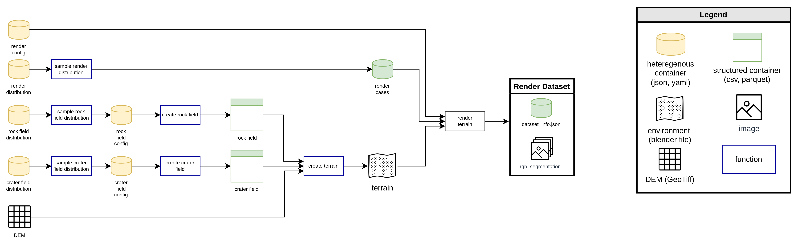

# User Guide

LuNaSynth takes a Digital Elevation Model (DEM) of the Moon, adds rocks and craters at a higher
resolution than the DEM, and renders the terrain with [Blender](https://www.blender.org/) (`bpy`)
to produce images, depth maps and segmentation masks:

**base mesh** → **+ rock field + crater field** → **terrain** → **render cases (camera + sun)** → **dataset**



## Installation

LuNaSynth requires Python 3.11. The recommended way to install it is with [uv](https://docs.astral.sh/uv/),
which also downloads the required Python version:

```bash
git clone https://github.com/nasa-jpl/lunasynth.git
cd lunasynth
uv sync
```

Prepend `uv run` to any command to run it in the project environment, or activate it with
`source .venv/bin/activate`. You can also install the package with pip:

```bash
python3 -m pip install -e .
```

See the [README](../../README.md#install-lunasynth-package) for system dependencies.

## Concepts

Base mesh
: The starting terrain: a GeoTIFF DEM (for example `assets/base_meshes/*.tif`) or a Blender file.

Rock field
: A set of rocks with position, diameter, height and rotation. The number and size of rocks follow
  the cumulative fractional area (CFA) model, see {py:class}`~lunasynth.terrain_enhancement.RockField`.

Crater field
: A set of craters with position and diameter that are carved into the DEM, see
  {py:class}`~lunasynth.terrain_enhancement.CraterField`.

Render cases
: The camera pose and sun direction of each rendered image. They are sampled from distributions
  defined in a configuration file, see {py:class}`~lunasynth.configuration_manager.CaseManager`.

Dataset
: For each base mesh and terrain sample, a folder with the rendered images (`rgb_*.png`,
  `depth_*.exr`, `segmentation_*.png`) and a `params.json` describing every case.

## Generate a dataset

The main entry point is `generate_dataset`, which runs the full pipeline from a YAML configuration
file. Configuration files for the published datasets are in `config/datasets/`:

```bash
uv run generate_dataset --dataset-config config/datasets/ortho_minimal.yaml
```

Any value of the configuration file can be overridden from the command line with `--set`, using dots
for nested keys:

```bash
uv run generate_dataset --dataset-config config/datasets/ortho_minimal.yaml \
    --set rendering.resolution_x=256 rendering.resolution_y=256 terrain.samples=2 \
          output.output_root=tmp/datasets
```

A dataset configuration has these sections:

```yaml
name: "minimal"
base_mesh:
  meshes: ["assets/base_meshes/NPB_final_adj_5mpp_surf_piece_1km_2_12.tif"]
terrain:
  desired_spatial_resolution: 0.6   # meters per pixel of the enhanced terrain
  samples: 1                        # terrains generated per base mesh
  rock_field:
    h_min: 1.0
    h_max: 10.0
    density: {type: "uniform", min: 0.01, max: 0.02}
  crater_field:
    h_min: 1.0
    h_max: 20.0
    density: {type: "uniform", min: 0.1, max: 0.2}
rendering:
  camera_type: "ORTHO"
  resolution_x: 320
  resolution_y: 320
  depth_output: true
  segmentation_output: true
rendering_cases:
  cases: 2                          # renders per terrain
  distributions:
    sun/elevation: {type: "uniform", min: 0.1, max: 0.2}
    sun/azimuth: {type: "uniform", min: 0.0, max: 6.28}
output:
  output_root: "tmp/datasets/"
```

The [dataset generation tutorial](../../src/tutorials/render_dataset_tutorial.ipynb) explains every
option and how to read the resulting dataset.

## Command line tools

Each step of the pipeline is also available as a script in `src/lunasynth/cli/`. Run any of them
with `--help` to see its options. The most common ones are installed as commands:

| Command | Script | Description |
|---|---|---|
| `generate_dataset` | `generate_enhanced_moon_terrain_dataset.py` | Full pipeline from a dataset configuration file |
| `create_rock_field` | `create_rock_field.py` | Generate a rock field and save it as CSV |
| `load_rocks` | `load_rocks.py` | Place the rocks of a CSV rock field on a Blender terrain |

Other scripts generate crater fields (`create_crater_field.py`), add craters to a mesh
(`add_craters_mesh.py`), sample render cases (`process_sampling_cases.py`), render a trajectory
(`process_traj_cases.py`) or a Blender file (`render_blendfile.py`). The pipelines in
`scripts/pipelines/` show how to chain them:

```bash
uv run create_rock_field --CFA 0.04 --size_x 100 --size_y 100 --h_min 0.6 --h_max 10.0 \
    --output tmp/moon_rock_field
uv run load_rocks --blend-file assets/base_meshes/moon_mesh_LOLA_10km_10mpp.blend \
    --rock-field-file tmp/moon_rock_field.csv --output-blend-file tmp/moon_rocks.blend
```

## Use the library from Python

The same building blocks can be used directly. For example, to generate rock and crater fields and
carve the craters into a DEM:

```python
import numpy as np
from lunasynth.terrain_enhancement import CraterField, RockField

# rocks: 6% cumulative fractional area, 20 x 20 m, rock diameters between 0.4 and 4 m
rock_field = RockField()
rock_field.generate_rock_field(k=0.06, size_x=20, size_y=20, h_min=0.4, h_max=4.0, seed=0)
rock_field.save("rock_field.csv")

# craters on a flat 40 x 40 m DEM at 0.5 m/px
crater_field = CraterField()
crater_field.generate(k=1.0, size_x=40, size_y=40, h_min=2.0, h_max=20.0, seed=0)
dem = crater_field.place_craters_dem(crater_field.craters, np.zeros((80, 80)), pixel_size=0.5)
crater_field.save("crater_field.csv")
```

To run the full pipeline from Python, load a configuration with
{py:class}`~lunasynth.config_loader.ConfigLoader` and pass it to
{py:class}`~lunasynth.configuration_manager.RenderingManager`:

```python
from lunasynth.config_loader import ConfigLoader
from lunasynth.configuration_manager import RenderingManager

config = ConfigLoader(
    "config/datasets/ortho_minimal.yaml",
    ["rendering.resolution_x=128", "rendering.resolution_y=128"],
).config
RenderingManager(dataset_config=config).run_dataset_generation()
```

Importing modules that use Blender ({py:mod}`lunasynth.blender_helper`,
{py:mod}`lunasynth.configuration_manager`) writes a `blender_render.log` file. Set the
`LUNASYNTH_LOG_DIR` environment variable to choose where log files are written.

See the [API reference](../api/index) for all modules, classes and functions.

## Use a generated dataset

If you only want to use a dataset generated with LuNaSynth, see the "Using the dataset" section of the
[dataset generation tutorial](../../src/tutorials/render_dataset_tutorial.ipynb), and the
[dataset analysis notebook](../../test/dataset_analysis.ipynb) for examples of loading and plotting the
images, depth maps and segmentation masks.
